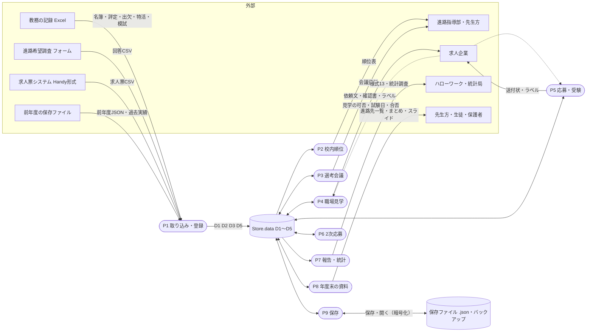
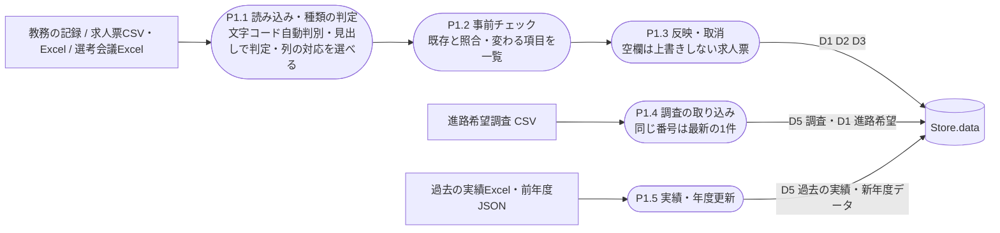
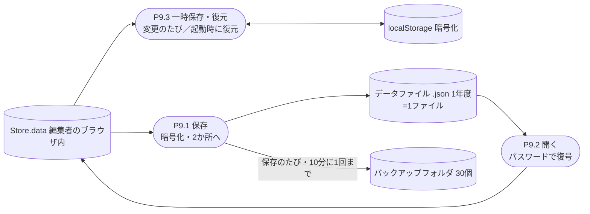

# データフロー図（DFD）

2026-11-21 に、ホワイトボード版（2026-11-20 作成・v0.6.0 時点）を文書に写した。**設計の見取り図**として使う。
画面や保存項目を足したら、ここも直す。個人名・学校名は書かない。

> 基本の形：**全画面が `Store.data`（JSON 1ファイル＝1年度）を読み書きし、帳票は毎回そこから作る。**
> 手入力・確認・印刷はすべて進路担当者が行う（編集者は1人）。

## 凡例

- 外部＝人・システム／P＝処理（画面・機能）／D＝データストア（保存されるデータ）
- D1 生徒・成績　D2 求人票　D3 応募　D4 設定・帳票　D5 調査・過去の実績

## レベル1

| 処理 | 読む | 書く |
|---|---|---|
| P1 取り込み・登録 | 取り込み済み記録 | D1 D2 D3 D5（様式を自動判定・事前チェック・取り消し可） |
| P2 校内順位 | D1 D4（規定値） | **なし**（毎回計算。保存しない） |
| P3 選考会議 | D1 D2 | D3（希望1〜5・確定） |
| P4 職場見学 | D2 D3 D4 | D3（見学の記録）、D2（送付先の変更） |
| P5 応募・受験 | D2 D3 D4 | D3（送付・試験・合否）、D2（送付先の修正） |
| P6 2次応募 | D1 D3 | D3（2次以降の応募） |
| P7 報告・統計 | D1 D2 D3 | なし（印刷・Excel） |
| P8 年度末の資料 | D1 D3 D5 | D1（進路先）、D5（今年度の実績） |
| P9 保存 | D1〜D5 すべて | ファイル・バックアップ・一時保存 |

## レベル2：P1 取り込み・登録

取り込み済みファイルの記録（名前・サイズ・更新日時）は `data.imports` に残り、二重取り込みを防ぐ。取り込みフォルダのハンドルは IndexedDB。

## レベル2：P9 保存

保存・バックアップ・一時保存は、暗号化を設定していればすべて暗号化されたまま。

## 図にまだ無いもの（v0.6.0 のあとに増えた機能）

ホワイトボードは 2026-10-23 版のため、次が欠けている。DFD を直すときに足す。

| 機能 | 流れ |
|---|---|
| 共有（`share.js`） | P9.1 の保存のたびに `shared-data.js` を公開フォルダへ書く → 閲覧側（`?view=1`、読むだけ）が30秒ごとに読む |
| 起動のパスワード（`auth.js`） | 全処理の前に立つ関門。通ると `Auth.pw`（メモリ）に持ち、暗号化ファイルを自動で開く |
| 取り込みフォルダ（`watch.js`） | 新しい求人票 CSV を検出 → P1.1 へ |
| 進路決定の取り込み（進学・就職） | CSV/Excel → `OutImport` → D1 の `dest`・進路変更履歴 |
| 進路の変更（`Outcomes.change`） | 進学⇔就職で `destLog`・`destStash`・`course`・応募の辞退をそろえる（1か所に集約） |
| 帳票の設定（`docset.js`） | D4 `docLayout` を読み、依頼文・確認書・送付状・ラベルを組み立てる |
| 進路希望調査の画面・年度末の資料・説明会スライド | D5・D1 を読み、印刷・Excel・PowerPoint を出力 |
| 教育委員会 内定状況（P7） | D1 D3 を読む。希望者数は10月末で固定、内定は結果日で区切る |

## 変更の作法（データの流れを守る）

1. データを書き換える → 2. `Store.changed()` → 3. 必要なら `UI.refresh()`。
データ形式を変えたら `normalizeData` に移行を足し、古い JSON も開けるようにする。
